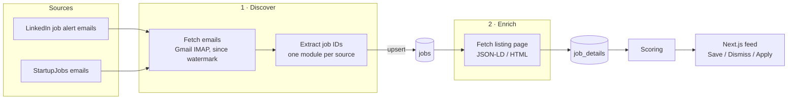

# Job Hunter

A personal job radar. It discovers job listings in job alert emails, deduplicates them, fetches their full details from the listing pages, stores everything in Postgres, and (soon) scores jobs for relevance and shows them in a simple feed.

It's a tool I use during my own job search, and also a Data Engineering portfolio project: source-specific ingestion into a common data model, separate discovery and enrichment stages, incremental loading, idempotent writes, and a schema managed through migrations.

The guiding principle is **high signal > complete coverage**: a small stream of relevant jobs beats every job on the internet.

## Architecture



**Emails discover jobs; listing pages describe them.** Job alert emails come in several layouts that change without warning, and their previews are incomplete: StartupJobs omits the location, and LinkedIn mixes in badges such as "actively hiring". So emails are used only to find job IDs. Everything else is fetched from the job's listing page, which is also the only place that has the description and salary needed for scoring.

| Table | Written by | Contents |
| --- | --- | --- |
| `jobs` | discovery | `source`, `source_id`, `url`, `discovered_at` (when the first email mentioning it arrived), `email_work_style` |
| `job_details` | enrichment | `title`, `company`, `location`, `work_style`, `salary`, `description`, `closed`, `fetched_at` |
| `ingestion_state` | discovery | watermark for each source |

`(source, source_id)` is the job's identity, for example `linkedin` / `4473329863`. The database enforces it with a unique constraint.

Each source module handles both stages:

| Source | Discovery | Enrichment |
| --- | --- | --- |
| LinkedIn | job alert emails (`jobalerts-noreply@linkedin.com`), plus the work style marker from the card | public guest endpoint (HTML) |
| StartupJobs | `jobot@startupjobs.cz` emails | schema.org `JobPosting` JSON-LD embedded in the page, work style tags |

`work_style` is a list of `onsite` / `hybrid` / `remote`, because a job may allow several; `null` means unknown. It comes from the listing page when the page shows it. LinkedIn hides it from logged-out visitors, so for LinkedIn it comes from the email card ("Praha (Hybrid)"). That's the one detail taken from an email, and it's deliberate: scraping LinkedIn with a logged-in session would risk your account.

### Design decisions

- **Discovery and enrichment are separate stages.** Discovery only needs a regex that finds job IDs, so it survives email redesigns. Enrichment reads the most structured source available. schema.org `JobPosting` is also used by Greenhouse, Lever, Ashby and many career pages, which makes future sources cheap. Each table has exactly one writer, and a job without a `job_details` row is simply waiting for enrichment.
- **Rate limits don't fail the run.** If a site answers 429, enrichment skips that source until the next run, and the other sources continue.
- **Closed listings are kept, not deleted.** A 404 or a "no longer accepting applications" page is stored as `closed = true`, so the feed can hide the job and history is kept.
- **Incremental loading with a watermark.** `ingestion_state` stores, for each source, the time the newest processed email was received. Each run asks Gmail only for emails after that time, minus a one-hour overlap that covers emails Gmail indexes late. New sources start from the moment they're added, with no backlog of stale jobs.
- **Idempotent writes.** Jobs are upserted (`INSERT ... ON CONFLICT (source, source_id) DO UPDATE`), so re-processing an email never creates duplicates. That makes the overlap window harmless. The upsert keeps the earliest `discovered_at`, so a backfill dates jobs correctly.
- **No lost emails.** Each source's jobs and its watermark update commit in one transaction. If a run fails, the watermark doesn't move and the next run picks the emails up again.
- **Freshness is visible.** `ingestion_state.last_checked_at` records each source's last successful check, even when no new emails arrived. The feed shows the oldest one, so a source that keeps failing shows up as stale.
- **Schema owned by SQL migrations.** `supabase/migrations/` is the single source of truth. The Next.js app uses Prisma for queries only and reads the schema from the database (`prisma db pull`). It never runs migrations.
- **Deterministic first.** Scoring will be rule-based, with explainable sub-scores. An LLM may come later, if at all.

## Stack

| Layer | Technology |
| --- | --- |
| Ingestion | Python, Gmail IMAP, requests + BeautifulSoup, psycopg |
| Database | Supabase (Postgres) |
| Migrations | Supabase CLI |
| Frontend (planned) | Next.js, TypeScript, Tailwind, shadcn/ui, Prisma |
| Scheduling | GitHub Actions cron, every 4 hours |

## Repository layout

```
job-hunter/
├── db/                      # shared Postgres connection (ingestion, later scoring)
├── ingestion/
│   ├── pipeline.py          # entry point: discover → enrich
│   ├── discover.py          # stage 1: emails → jobs
│   ├── enrich.py            # stage 2: listing pages → job_details
│   ├── gmail.py             # Gmail IMAP + incremental email fetching
│   ├── scraping.py          # shared HTTP session for listing pages
│   ├── models.py            # Email, Job, JobDetails
│   └── sources/             # one module per source: email parsing + listing page details
│       ├── linkedin.py
│       └── startupjobs.py
├── scoring/
│   ├── rules.py             # preferences + deterministic rules → sub-scores
│   └── score.py             # scoring stage: job_details → job_scores
├── supabase/
│   └── migrations/          # SQL migrations, applied in order
└── requirements.txt
```

## Setup

### 1. Python

```bash
python -m venv .venv
source .venv/bin/activate
pip install -r requirements.txt
```

### 2. Gmail

Ingestion reads Gmail over IMAP with an [app password](https://myaccount.google.com/apppasswords). A Google Cloud OAuth app in Testing mode expires its tokens every 7 days, and publishing one requires a homepage and a privacy policy, which is a lot of overhead for a script that reads your own mailbox.

1. Turn on 2-Step Verification for your Google account (app passwords require it).
2. Create an app password and add it to `.env` without the spaces:

   ```
   GMAIL_ADDRESS=you@gmail.com
   GMAIL_APP_PASSWORD=abcdefghijklmnop
   ```

The mailbox is opened read-only and searched with Gmail's own query syntax (`X-GM-RAW`), so each source's `GMAIL_QUERY` works just like in the Gmail search box. The app password itself grants full mailbox access, so keep it only in `.env` and GitHub secrets. Changing your Google password revokes it.

### 3. Supabase

1. Create a Supabase project.
2. Copy the **Session pooler** connection string (Connect → Connection string) into `.env`:

   ```
   DATABASE_URL=postgresql://postgres.<ref>:<password>@aws-0-<region>.pooler.supabase.com:5432/postgres
   ```

   The session pooler works over IPv4 and supports prepared statements. The direct connection is IPv6-only on the free plan.

3. Install the [Supabase CLI](https://supabase.com/docs/guides/cli) and apply the migrations:

   ```bash
   brew install supabase/tap/supabase
   supabase db push --db-url "$DATABASE_URL"
   ```

`.env` is gitignored.

## Usage

```bash
python -m ingestion.pipeline
```

```
linkedin: 2 emails since 2026-10-06 08:42, 8 job links
startupjobs: 1 emails since 2026-10-06 05:06, 2 job links
enriched 16 jobs
```

Each stage also runs on its own: `python -m ingestion.discover` or `python -m ingestion.enrich`. The second is useful for retrying enrichment after a rate limit without reading Gmail again.

**Scheduled runs:** `.github/workflows/ingest.yml` runs the pipeline and then scoring every 4 hours, and on demand from the Actions tab (Run workflow). It needs the three values from `.env` as repository secrets (Settings → Secrets and variables → Actions): `DATABASE_URL`, `GMAIL_ADDRESS` and `GMAIL_APP_PASSWORD`. To set them from `.env`: `gh secret set -f .env`.

**Scoring:** `python -m scoring.score` rescores every open job into `job_scores`: a 0–100 `score` plus the 0–1 sub-scores behind it. Each comes from `scoring/rules.py`:

| Sub-score | Weight | From |
| --- | --- | --- |
| `role` | 35 | Title: data engineering 1, backend 0.7, full stack 0.6, frontend 0.5, everything else 0 |
| `work_style` | 35 | Remote 1 (0.6 if based outside CZ/EU), hybrid 0.1, onsite 0, unknown 0.5 |
| `stack` | 15 | Title + description: share of 3 technologies from my list (Snowflake, dbt, SQL, Airflow, Python, …) |
| `seniority` | 10 | Title: none/mid 1, senior 0.6, junior 0.4, lead/principal 0.2 |
| `salary` | 5 | Top of the stated range ≥ 60k CZK/month 1, below 0, not stated 0.5 |

Every run rescores everything, so editing a rule applies to all jobs on the next run.

**Backfill:** move a source's watermark back in time, then run the pipeline as usual:

```sql
update ingestion_state set last_email_at = '2000-01-01' where source = 'startupjobs';
```

**Re-fetch details** (for example after fixing a source's scraper): delete the affected `job_details` rows. The next run fetches them again.

## Database migrations

```bash
supabase migration new add_scores                # creates supabase/migrations/<timestamp>_add_scores.sql
# write the SQL
supabase db push --db-url "$DATABASE_URL"        # applies migrations that haven't run yet
```

- Applied migrations are tracked in `supabase_migrations.schema_migrations`.
- Never edit a migration that has already been applied; add a new one.
- Enable row-level security on every new table. Supabase exposes the `public` schema through its REST API.
- After schema changes, the frontend refreshes its Prisma client with `prisma db pull && prisma generate`.

## Adding a source

1. Create `ingestion/sources/<source>.py` exposing:
   - `SOURCE`, `GMAIL_QUERY`, `MIME_TYPE`
   - `parse_jobs(email) -> list[Job]`: jobs found in an email (ID, canonical URL, plus any hint only the email has)
   - `fetch_details(source_id) -> JobDetails`: details from the listing page (prefer schema.org JSON-LD when the page has it)
2. Add the module to `SOURCES` in `ingestion/sources/__init__.py`.
3. Add a migration that inserts its watermark row into `ingestion_state` (`now()` = start from today).

## Roadmap

- [x] Job discovery from LinkedIn and StartupJobs emails
- [x] Persistence in Supabase with idempotent upserts
- [x] Incremental loading with watermarks
- [x] Enrichment from listing pages (details, work style, salary, description, closed listings)
- [x] Scheduled runs on GitHub Actions
- [x] Deterministic scoring (role, work style, tech stack, seniority, compensation) with explainable sub-scores
- [ ] Next.js feed with Save / Dismiss / Apply
- [ ] Learn preferences from feed actions
- [ ] More sources (Wellfound, Greenhouse, Lever, Ashby, company career pages)
