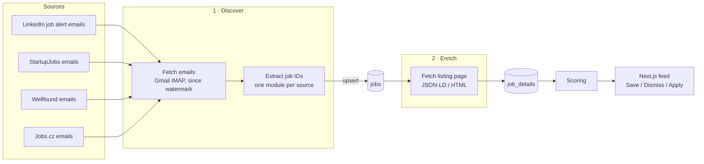

# Job Hunter

A personal job radar. It discovers job listings in job alert emails, deduplicates them, fetches their full details from the listing pages, stores everything in Postgres, scores jobs for relevance and shows them in a simple feed.

It's a tool I use during my own job search, and also a Data Engineering portfolio project: source-specific ingestion into a common data model, separate discovery and enrichment stages, incremental loading, idempotent writes, and a schema managed through migrations.

The guiding principle is **high signal > complete coverage**: a small stream of relevant jobs beats every job on the internet.

## Architecture



**Emails discover jobs; listing pages describe them.** Job alert emails come in several layouts that change without warning, and their previews are incomplete: StartupJobs omits the location, and LinkedIn mixes in badges such as "actively hiring". So emails are used only to find job IDs. Everything else is fetched from the job's listing page, which is also the only place that has the description and salary needed for scoring.

| Table | Written by | Contents |
| --- | --- | --- |
| `jobs` | discovery | `source`, `source_id`, `url`, `discovered_at` (when the first email mentioning it arrived), `email_work_style` |
| `job_details` | enrichment | `title`, `company`, `location`, `work_style`, `salary` (as shown, for display), `salary_min` / `salary_max` / `salary_currency` / `salary_period` (parsed, for scoring), `description`, `closed`, `fetched_at` |
| `ingestion_state` | discovery | watermark for each source |

`(source, source_id)` is the job's identity, for example `linkedin` / `4473329863`. The database enforces it with a unique constraint.

Each source module handles both stages:

| Source | Discovery | Enrichment |
| --- | --- | --- |
| LinkedIn | job alert emails (`jobalerts-noreply@linkedin.com`), plus the work style marker from the card | public guest endpoint (HTML) |
| StartupJobs | `jobot@startupjobs.cz` emails | schema.org `JobPosting` JSON-LD embedded in the page, work style tags |
| Wellfound | `team@hi.wellfound.com` digests (plain-text part; the HTML part only has tracking redirects) | listing page HTML (only about half embed JSON-LD), side-panel "Remote Work Policy" |
| Jobs.cz | `pomuzeme@jobs.cz` alerts: each tracking link is resolved to the listing ID; title, company and location from the card | listing page HTML (`data-test` hooks), work style from benefits; company career sites render in the browser, so the card's details stand in |

`work_style` is a list of `onsite` / `hybrid` / `remote`, because a job may allow several; `null` means unknown. It comes from the listing page when the page shows it. LinkedIn hides it from logged-out visitors, so for LinkedIn it comes from the email card ("Praha (Hybrid)"). That's the one detail taken from an email, and it's deliberate: scraping LinkedIn with a logged-in session would risk your account.

### Design decisions

- **Discovery and enrichment are separate stages.** Discovery only needs a regex that finds job IDs, so it survives email redesigns. Enrichment reads the most structured source available. schema.org `JobPosting` is also used by Greenhouse, Lever, Ashby and many career pages, which makes future sources cheap. Each table has exactly one writer, and a job without a `job_details` row is simply waiting for enrichment.
- **Rate limits don't fail the run.** If a site answers 429, enrichment skips that source until the next run, and the other sources continue.
- **Closed listings are kept, not deleted.** A 404 or a "no longer accepting applications" page is stored as `closed = true`, so the feed can hide the job and history is kept.
- **Incremental loading with a watermark.** `ingestion_state` stores, for each source, the time the newest processed email was received. Each run asks Gmail only for emails after that time, minus a one-hour overlap that covers emails Gmail indexes late. New sources start from the moment they're added, with no backlog of stale jobs.
- **Idempotent writes.** Jobs are upserted (`INSERT ... ON CONFLICT (source, source_id) DO UPDATE`), so re-processing an email never creates duplicates. That makes the overlap window harmless. The upsert keeps the earliest `discovered_at`, so a backfill dates jobs correctly.
- **No lost emails.** Each source's jobs and its watermark update commit in one transaction. If a run fails, the watermark doesn't move and the next run picks the emails up again.
- **Freshness is visible.** `ingestion_state.last_checked_at` records each source's last successful check, even when no new emails arrived. The feed shows the oldest one, so a source that keeps failing shows up as stale.
- **Schema owned by SQL migrations.** `supabase/migrations/` is the single source of truth. The Next.js app uses Prisma for queries only and reads the schema from the database (`prisma db pull`). It never runs migrations.
- **Deterministic first.** Scoring is rule-based, with explainable sub-scores. An LLM may come later, if at all.

## Stack

| Layer | Technology |
| --- | --- |
| Ingestion | Python, Gmail IMAP, requests + BeautifulSoup, psycopg |
| Database | Supabase (Postgres) |
| Migrations | Supabase CLI |
| Frontend | Next.js, TypeScript, Tailwind, shadcn/ui, Prisma (queries only), Vercel |
| Scheduling | GitHub Actions cron, every 4 hours |

## Repository layout

```
job-hunter/
├── db/                      # shared Postgres connection (ingestion, scoring)
├── ingestion/
│   ├── pipeline.py          # entry point: discover → enrich
│   ├── discover.py          # stage 1: emails → jobs
│   ├── enrich.py            # stage 2: listing pages → job_details
│   ├── gmail.py             # Gmail IMAP + incremental email fetching
│   ├── scraping.py          # shared HTTP session for listing pages
│   ├── models.py            # Email, Job, JobDetails
│   └── sources/             # one module per source: email parsing + listing page details
│       ├── jobscz.py
│       ├── linkedin.py
│       ├── startupjobs.py
│       └── wellfound.py
├── scoring/
│   ├── rules.py             # preferences + deterministic rules → sub-scores
│   └── score.py             # scoring stage: job_details → job_scores
├── supabase/
│   └── migrations/          # SQL migrations, applied in order
├── tests/                   # pytest: source parsers + scoring rules
│   └── fixtures/            # saved listing pages, served instead of the network
├── web/                     # Next.js feed (deployed on Vercel)
│   ├── app/                 # feed page, login, server actions
│   ├── lib/                 # Prisma client, feed queries, auth
│   ├── prisma/              # schema.prisma, pulled from the database
│   └── proxy.ts             # password protection
├── .env.example             # template for .env (web/.env.example for the web app)
├── requirements.txt
└── requirements-dev.txt     # + pytest
```

## Run it yourself

Everything runs on free tiers: Gmail, Supabase, GitHub Actions and Vercel. Setup takes about half an hour.

You need Python 3.12, Node.js 22.12 or newer (Prisma 7), a Gmail account, and accounts on [Supabase](https://supabase.com), GitHub and [Vercel](https://vercel.com).

### 1. Fork and install

Fork the repo on GitHub (the scheduled runs use your fork's Actions), then:

```bash
git clone https://github.com/<you>/job-hunter.git
cd job-hunter
python -m venv .venv
source .venv/bin/activate
pip install -r requirements-dev.txt   # runtime deps + pytest
pytest                                # no network or database needed
cp .env.example .env
cp web/.env.example web/.env
```

### 2. Subscribe to job alerts

The pipeline only knows about jobs that reach your Gmail inbox as alert emails. Save searches with email alerts on any of the supported sites: [LinkedIn](https://www.linkedin.com/jobs/), [StartupJobs](https://www.startupjobs.cz), [Wellfound](https://wellfound.com) and [Jobs.cz](https://www.jobs.cz). You don't need all four; a source with no emails simply finds nothing.

The alerts must arrive directly in that inbox, not forwarded, because each source finds its emails by sender (`GMAIL_QUERY` in `ingestion/sources/<source>.py`).

### 3. Gmail app password

Ingestion reads Gmail over IMAP with an [app password](https://myaccount.google.com/apppasswords). A Google Cloud OAuth app in Testing mode expires its tokens every 7 days, and publishing one requires a homepage and a privacy policy, which is a lot of overhead for a script that reads your own mailbox.

1. Turn on 2-Step Verification for your Google account (app passwords require it).
2. Create an app password and put it in `.env` as `GMAIL_APP_PASSWORD`, without the spaces, next to `GMAIL_ADDRESS`.

The mailbox is opened read-only and searched with Gmail's own query syntax (`X-GM-RAW`), so each source's `GMAIL_QUERY` works just like in the Gmail search box. The app password itself grants full mailbox access, so keep it only in `.env` and GitHub secrets. Changing your Google password revokes it.

### 4. Supabase

1. Create a Supabase project. Save the database password; Supabase shows it only once (you can reset it under Project Settings → Database).
2. Copy the **Session pooler** connection string (Connect → Session pooler) into `.env` as `DATABASE_URL`, with your password filled in. If the password has characters such as `@`, `#` or `/`, URL-encode them or pick one with only letters and digits.

   The session pooler works over IPv4 and supports prepared statements. The direct connection is IPv6-only on the free plan.

3. Create the tables by applying the migrations with the [Supabase CLI](https://supabase.com/docs/guides/cli) (`brew install supabase/tap/supabase`, or prefix the command with `npx`):

   ```bash
   source .env
   supabase db push --db-url "$DATABASE_URL"
   ```

### 5. First run

```bash
python -m ingestion.pipeline   # emails → jobs → job_details
python -m scoring.score        # job_details → job_scores
```

Each source starts from the moment its migration ran, so the first run finds only emails that arrived after that. To pick up the alerts already in your inbox, move the watermarks back first (Supabase → SQL Editor):

```sql
update ingestion_state set last_email_at = now() - interval '30 days';
```

### 6. Make the scoring yours

The preferences in `scoring/rules.py` are mine: data engineering roles, remote work in Czechia or the EU, my tech stack, mid-level seniority and a salary floor in CZK. Edit them to match what you're looking for:

| Constant | What it decides |
| --- | --- |
| `WEIGHTS` | how many of the 100 points each sub-score is worth |
| `ROLES` | title patterns and how well each role fits |
| `STACK`, `STACK_FULL_MATCH` | technologies you want, and how many make a full match |
| `SENIORITY` | title patterns for seniority levels |
| `WORK_STYLE`, `REMOTE_REGION`, `REMOTE_ABROAD` | remote / hybrid / onsite preference, and where a remote job may be based |
| `SALARY_FLOOR_CZK_MONTH`, `CZK_PER` | lowest acceptable salary, and exchange rates |

Then update `tests/test_rules.py`, which checks the current preferences, and run `python -m scoring.score` again. Every run rescores every job.

### 7. Web app

Fill in `web/.env`: `DATABASE_URL` is the same URL as in `.env` but with port `6543` (the **transaction pooler**), and `APP_PASSWORD` is the password for the feed's login page. The session pooler (`5432`) allows only 15 clients in total, and serverless instances each open their own pool, so the web app uses the transaction pooler. The Python pipeline keeps the session pooler.

```bash
cd web
npm install                  # also runs `prisma generate`
npm run dev                  # http://localhost:3000
```

### 8. Deploy

**Scheduled runs on GitHub Actions.** `.github/workflows/ingest.yml` runs the pipeline and then scoring every 4 hours, and on demand from the Actions tab (Run workflow).

1. Add the three values from `.env` as repository secrets (Settings → Secrets and variables → Actions): `DATABASE_URL`, `GMAIL_ADDRESS` and `GMAIL_APP_PASSWORD`. With the [GitHub CLI](https://cli.github.com): `gh secret set -f .env`.
2. GitHub turns off workflows in forks. Open the Actions tab, enable them, and run **Ingest** once by hand to check the secrets.

**Feed on Vercel.** Import your fork, set **Root Directory** to `web`, and add `DATABASE_URL` (transaction pooler, port 6543) and `APP_PASSWORD` as environment variables. Everything else is auto-detected.

`.env` and `web/.env` are gitignored; only the `.env.example` templates are committed.

## Usage

```bash
python -m ingestion.pipeline
```

```
linkedin: 2 emails since 2026-10-06 08:42, 8 job links
startupjobs: 1 emails since 2026-10-06 05:06, 2 job links
enriched 16 jobs
```

Each stage also runs on its own: `python -m ingestion.discover` or `python -m ingestion.enrich`. The second is useful for retrying enrichment after a rate limit without reading Gmail again.

**Scoring:** `python -m scoring.score` rescores every open job into `job_scores`: a 0–100 `score` plus the 0–1 sub-scores behind it. Each comes from `scoring/rules.py`:

| Sub-score | Weight | From |
| --- | --- | --- |
| `role` | 35 | Title: data engineering 1, backend 0.7, full stack 0.6, frontend 0.5, everything else 0 |
| `work_style` | 35 | Remote 1 (0.6 if based outside CZ/EU), hybrid 0.1, onsite 0, unknown 0.5 |
| `stack` | 15 | Title + description: share of 3 technologies from my list (Snowflake, dbt, SQL, Airflow, Python, …) |
| `seniority` | 10 | Title: none/mid 1, senior 0.6, junior 0.4, lead/principal 0.2 |
| `salary` | 5 | Top of the stated range ≥ 60k CZK/month 1, below 0, not stated 0.5 |

Every run rescores everything, so editing a rule applies to all jobs on the next run.

**Feed:** the web app (design from the `pixel-perfect` prototype) lists open, scored jobs in "Worth your time" (score ≥ 70) and "Other matches", with search, work-style, score and sort filters. Cards show the matched technologies (`job_scores.technologies`) and every sub-score; the job page adds score bars and the full description. **Save**, **Mark as applied** and **Dismiss** write `job_actions` (one row per job, the current decision; dismissing offers Undo). Saved, Applied and Dismissed have their own pages; Applications track a status (applied → interview → offer / rejected) in `job_actions.application_status`. The header shows when emails were last checked. A single password (`APP_PASSWORD`) protects everything: `proxy.ts` redirects to the login page without a valid session cookie, and every server action checks the session again.

**Backfill:** move a source's watermark back in time, then run the pipeline as usual:

```sql
update ingestion_state set last_email_at = '2000-01-01' where source = 'startupjobs';
```

**Re-fetch details** (for example after fixing a source's scraper): delete the affected `job_details` rows. The next run fetches them again.

## Database migrations

```bash
supabase migration new add_scores                # creates supabase/migrations/<timestamp>_add_scores.sql
# write the SQL
supabase db push --db-url "$DATABASE_URL"        # applies migrations that haven't run yet
```

- Applied migrations are tracked in `supabase_migrations.schema_migrations`.
- Never edit a migration that has already been applied; add a new one.
- Enable row-level security on every new table. Supabase exposes the `public` schema through its REST API.
- After schema changes, refresh the web app's Prisma schema and client: `cd web && npm run db:pull`.

## Adding a source

1. Create `ingestion/sources/<source>.py` exposing:
   - `SOURCE`, `GMAIL_QUERY`, `MIME_TYPE`
   - `parse_jobs(email) -> list[Job]`: jobs found in an email (ID, canonical URL, plus any hint only the email has)
   - `fetch_details(source_id, url) -> JobDetails`: details from the listing page (prefer schema.org JSON-LD when the page has it)
2. Add the module to `SOURCES` in `ingestion/sources/__init__.py`.
3. Add a migration that inserts its watermark row into `ingestion_state` (`now()` = start from today).
4. Add `tests/test_<source>.py`: an inline email snippet for `parse_jobs`, and a saved listing page in `tests/fixtures/` for `fetch_details` (one per page layout, plus the closed status code).
